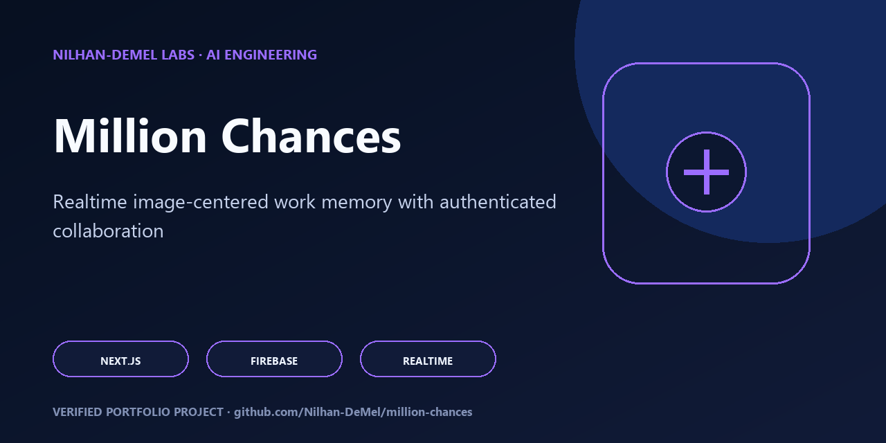

# Million Chances

<!-- portfolio-flagship -->
<p align="center"></p>

> **Portfolio review path:** Start with the capabilities and architecture below, then reproduce the documented verification commands. See [SECURITY.md](SECURITY.md), [CONTRIBUTING.md](CONTRIBUTING.md), and [RIGHTS.md](RIGHTS.md) for the project's operating and reuse boundaries.

An authenticated, image-centered work-memory prototype built with Next.js and Firebase.

Million Chances explores a simple idea: a work memory becomes easier to revisit when its image, notes, and discussion live together as one durable card. Users authenticate, create image-card stubs, upload media with progress feedback, search the gallery, edit owner-controlled notes, and continue a real-time message thread around each card.

## Engineering highlights

- **Modern App Router stack:** Next.js 16, React 19, TypeScript, Tailwind CSS, shadcn-style primitives, Motion, and TanStack Query.
- **Realtime domain model:** Firestore image cards and nested messages use typed adapters, live listeners, transactions, and bounded queries.
- **Resilient media flow:** Firebase Storage uploads expose progress, retry states, one-time image assignment, and reusable smart-image handling.
- **Authentication boundaries:** protected routes and Google sign-in are paired with owner checks in application logic.
- **Rules-as-code:** Firestore and Storage default-deny policies are exercised against local Firebase emulators.
- **Product-quality states:** responsive gallery layouts, skeletons, empty/error states, search, accessibility checks, and Open Graph assets.

## Architecture

```text
Next.js App Router
  |-- protected home and gallery
  |-- dynamic image-card workspace
  |-- login and diagnostic routes
  |
  +-> Firebase Auth
  +-> Firestore: imageCards/{cardId}/messages/{messageId}
  +-> Storage: imageCards/{cardId}/...
  +-> TanStack Query + realtime listeners
```

| Area | Responsibility |
| --- | --- |
| `src/app` | Routes, layouts, gallery, card workspace, login, and diagnostics |
| `src/components/auth` | Session context and protected-route behavior |
| `src/lib/firestore` | Typed cards, notes, message transactions, and listeners |
| `src/lib/firebase` | Browser configuration, authentication, and storage adapters |
| `tests/rules` | Firestore and Storage authorization contracts |
| `tests` | Browser smoke, accessibility, and task-verification journeys |

## Local setup

Copy [`.env.example`](.env.example) to `.env.local` and supply a Firebase Web App configuration for a development project. Then run:

```bash
npm ci
npm run dev
```

The `NEXT_PUBLIC_FIREBASE_*` values are browser configuration, not server credentials. They are bundled into the client by design, so their API key must be restricted in Google Cloud and authorization must remain enforced by Firebase rules. Administrative credentials do not belong in this repository.

## Verification

```bash
npm run lint
npx firebase emulators:exec --project demo-million-chances --only "firestore,storage" "npm run test:rules"
npm run build
```

The employer-release baseline passes ESLint, all 13 Firebase emulator rule tests, and the production Next.js build when the documented public Firebase configuration is supplied.

## Scope

This is a working application prototype and architecture demonstration, not a claim of a finished multi-tenant knowledge platform. Project grouping is explicitly marked as future work in the UI. Before production use, provision a dedicated Firebase project, restrict its browser key, review collaborative update permissions, and run the included browser suite against the intended deployment.
